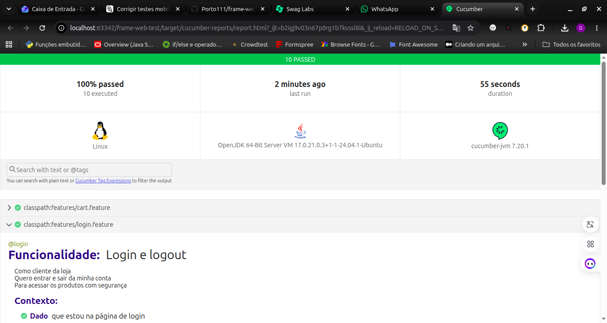

# Frame Web Test

[](https://github.com/Porto111/frame-web-test/actions/workflows/tests.yml)

Projeto de **automação de testes web** com Java, Selenium e Cucumber (BDD), feito para demonstrar boas práticas de QA Automation: código organizado, testes estáveis, relatório com evidências e execução automática no CI.

O sistema testado é o [Sauce Demo](https://www.saucedemo.com/), um e-commerce público criado pela Sauce Labs justamente para prática de automação.

## O que é testado

| Funcionalidade | Cenários |
|---|---|
| **Login e logout** | login válido, 5 tentativas inválidas (usuário inexistente, senha errada, campos em branco, usuário bloqueado) e logout |
| **Carrinho** | adicionar 1 produto, adicionar 2 produtos e remover produto |

Os cenários são escritos em Gherkin, em português, para que qualquer pessoa (QA, dev ou negócio) consiga ler e entender. Exemplo:

```gherkin
Cenário: Login com credenciais válidas
  Quando eu faço login com o usuário "standard_user" e a senha "secret_sauce"
  Então devo ver a página de produtos
```

## Tecnologias

- **Java 17** e **Maven**
- **Selenium WebDriver**: automação do navegador
- **Cucumber (BDD)**: cenários em Gherkin
- **JUnit 5**: execução dos testes
- **AssertJ**: verificações com mensagens claras
- **GitHub Actions**: execução automática a cada push e pull request

## Como rodar

Pré-requisitos: Java 17+, Maven e o Google Chrome instalados.

```bash
git clone https://github.com/Porto111/frame-web-test.git
cd frame-web-test
mvn test
```

Opções úteis:

```bash
mvn test -Dheadless=true                    # sem abrir a janela do navegador
mvn test -Dbrowser=firefox                  # outro navegador (chrome, firefox ou edge)
mvn test -Dcucumber.filter.tags="@smoke"    # só os testes rápidos (smoke)
mvn test -Dcucumber.filter.tags="@negativo" # só os cenários negativos
```

## Relatório

Ao terminar, o relatório fica em `target/cucumber-reports/report.html`. Quando um cenário falha, o relatório traz um **screenshot** da tela no momento do erro.

No GitHub, o relatório de cada execução pode ser baixado na aba **Actions**, no item *relatorio-cucumber*.

## Estrutura do projeto

```text
src/test
├── java
│   ├── config/    Config.java          leitura das configurações
│   ├── driver/    DriverFactory.java   abre e fecha o navegador
│   ├── pages/     BasePage, LoginPage, ProductsPage   (Page Objects)
│   ├── steps/     LoginSteps, CartSteps               (passos do Gherkin)
│   ├── hooks/     Hooks.java           screenshot em falha e fechamento do navegador
│   └── runner/    TestRunner.java      ponto de entrada da execução
└── resources
    ├── features/  login.feature, cart.feature
    ├── config.properties
    └── logback-test.xml
```

## Decisões técnicas

- **Page Object Model**: cada tela tem uma classe com seus elementos e ações. Se a tela mudar, o ajuste é feito em um único lugar.
- **Esperas explícitas, sem `Thread.sleep`**: toda ação espera o elemento ficar pronto antes de agir. Os testes ficam mais rápidos e muito menos instáveis.
- **Sem dados fixos no código**: URL, navegador e tempo de espera ficam no `config.properties` e podem ser trocados pela linha de comando.
- **Navegador isolado por cenário**: cada cenário abre e fecha seu próprio navegador, então um teste nunca interfere no outro.
- **Evidência de falha**: o screenshot é anexado ao relatório automaticamente.

## Próximos passos

- [ ] Testes de API com RestAssured
- [ ] Relatório com Allure
- [ ] Execução em paralelo

## Autor

**Guilherme Porto**, QA Engineer · [LinkedIn](https://www.linkedin.com/in/guilherme-porto-qa) · [GitHub](https://github.com/Porto111)
